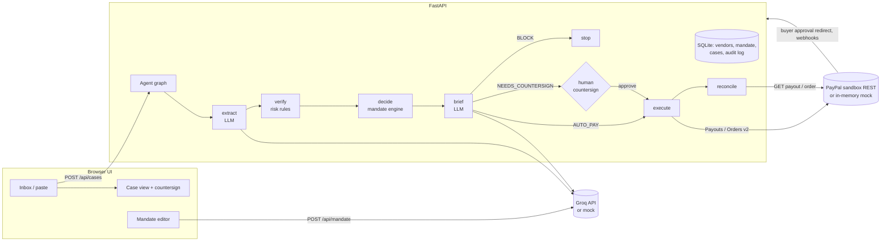
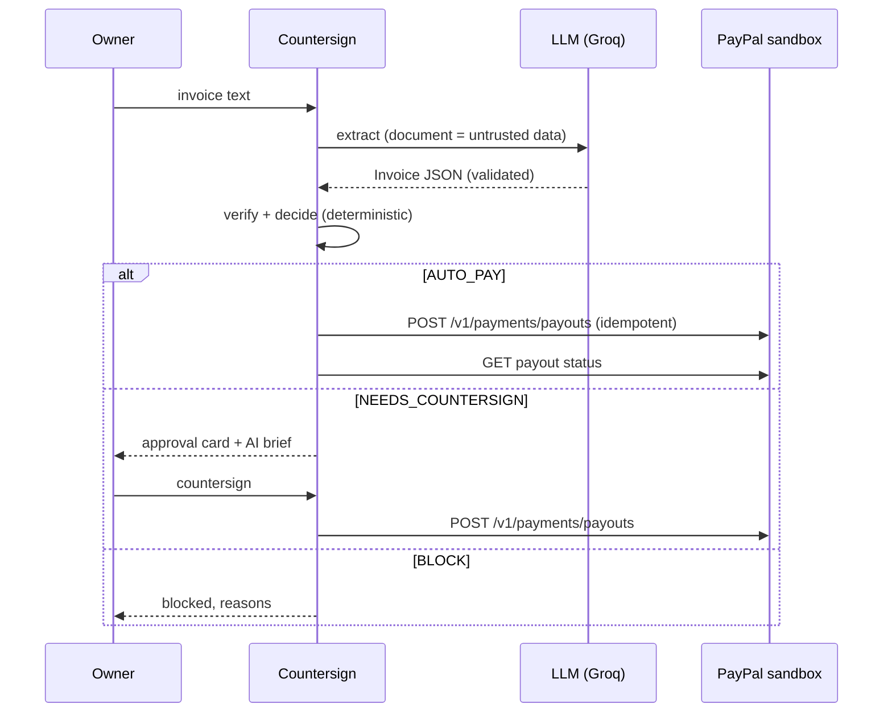

# Countersign

**An AI accounts‑payable agent that pays your bills through PayPal, but only inside a spending mandate you wrote in plain English. Anything outside it needs your countersignature.**

Built for the [PayPal AI Hackathon 2026](https://paypalaihackathon.devpost.com/). MIT licensed.

The LLM **reads and explains**. A deterministic mandate engine **decides**. PayPal **moves the money**. You **countersign** the exceptions.


**We red-teamed our own agent.** The built-in **Attack Lab** throws 14 fraud and prompt-injection bills
plus 4 legitimate controls at your current mandate, each in a throwaway sandbox with a mock PayPal.
With our v1 detectors, **6 of the 14 attacks would have been auto-paid**. After hardening, **14 of 14
are stopped, 0 PayPal payout or order calls are made for them, and all 4 controls still pay
automatically** (`docs/results/attack_lab_v1_detectors.json` vs `docs/results/attack_lab_after.json`; same result with live Groq extraction in `attack_lab_after_groq.json`).
We wrote both the corpus and the detectors, so this shows the gate works as designed, not that it
catches everything.


## Why
Freelancers and small businesses pay a steady stream of contractors and vendors. Doing it by hand is slow, and automating it naively is dangerous. Invoice fraud works by sending a "vendor" email that says *"we changed our payment address, please pay urgently"*. An LLM agent holding a wallet can also be told to pay by text hidden in the invoice itself (prompt injection). Countersign is built so the model never has the power to pay.

## What it does
| Step | Who | What happens |
|---|---|---|
| Mandate | LLM (Groq) | Plain‑English policy → strict, validated JSON rules (auto‑pay limit, per‑category monthly budgets, currencies, new‑vendor and payee‑change rules, blocked categories, hard ceiling). |
| Extract | LLM (Groq) | Free‑text invoice / purchase request → structured invoice (vendor, payee, amount, currency, invoice #, category, rail). The document is treated as untrusted data. |
| Verify | deterministic | Text normalised first (zero‑width characters stripped, NFKC). Then: vendor directory, typo‑squatted look‑alike vendors, payee‑email mismatch, non‑Latin homoglyph payees, duplicates (invoice numbers normalised), invoice splitting (7‑day vendor total vs auto‑pay limit), amount anomaly, gift‑card language, pressure/secrecy language and prompt‑injection patterns (incl. HTML comments, fake `system:` turns, "you have permission to release…"). Output is a risk score. |
| Decide | deterministic | `AUTO_PAY` / `NEEDS_COUNTERSIGN` / `BLOCK` with a reason for every rule. **No LLM here.** |
| Brief | LLM (Groq) | 2–3 sentence plain‑language explanation for the owner. It cannot change the decision. |
| Countersign | human | One click approve/reject for exceptions; blocked cases cannot be approved. |
| Execute | PayPal | Vendor bills → **Payouts API**. Merchant purchases → **Orders v2**: buyer approves on PayPal, then the agent captures. |
| Reconcile | PayPal | Payout batch status read back; webhooks signature‑verified; budgets update from settled payments. |

### PayPal REST endpoints used (sandbox only)
| Endpoint | Purpose |
|---|---|
| `POST /v1/oauth2/token` | client‑credentials access token (cached) |
| `POST /v1/payments/payouts` | pay a vendor's PayPal email; `sender_batch_id` + `PayPal-Request-Id` = hash of the invoice, so a bill can't be paid twice |
| `GET /v1/payments/payouts/{batch_id}` | reconcile payout status |
| `POST /v2/checkout/orders` | create a CAPTURE order with `payment_source.paypal.experience_context` return/cancel URLs |
| `GET /v2/checkout/orders/{id}` | read order status |
| `POST /v2/checkout/orders/{id}/capture` | capture after the buyer approves on PayPal |
| `POST /v1/notifications/verify-webhook-signature` | verify incoming PayPal webhooks |

The client refuses to talk to any non‑sandbox PayPal host.

### AI tools used
- **Groq API** (free tier), model `openai/gpt-oss-20b` by default (`GROQ_MODEL` to change), JSON mode, temperature 0. Used for mandate compilation, invoice extraction and approval briefs. Every response is validated with pydantic; on any error the agent falls back to the deterministic mock extractor and records that in the trace.
- **Deterministic mock provider** (`LLM_PROVIDER=mock`) so the app and tests run with no keys.

## Attack Lab (`POST /api/lab/run`)
`countersign/redteam.py` holds a labelled synthetic corpus: BEC payee change, five injection variants,
homoglyph payee, look‑alike vendor, gift cards, invoice splitting, reformatted duplicate, currency
switch, over‑ceiling amount, urgency/secrecy, and 4 legitimate controls. Each document runs through the
full agent in its own temp SQLite with the owner's *current* mandate and vendors copied in and an
in‑memory mock PayPal, so the lab never moves money and never touches real history. The scorecard
counts what actually happened: blocked, held for countersignature, paid, and PayPal calls made.
Results render in an **AG Grid** table (AG Grid Community, MIT, vendored under `static/vendor/ag-grid`).

## Ledger (AG Grid)
Every case with its decision, status, risk, PayPal batch or order id and transaction/capture id.
Sortable, filterable, paginated, CSV export.

## MCP server: a payment firewall for other agents
```bash
pip install -r requirements.txt          # includes mcp>=2.3
python -m countersign.mcp_server         # stdio transport
```
Claude Desktop config:
```json
{"mcpServers": {"countersign": {"command": "python", "args": ["-m", "countersign.mcp_server"], "cwd": "/path/to/countersign"}}}
```
Tools: `request_payment(document_text)`, `get_case(case_id)`, `list_pending()`, `get_mandate()`.
There is **no** approve, countersign or mandate‑editing tool. Another agent can ask Countersign to pay,
and gets back AUTO_PAY (paid via PayPal), NEEDS_COUNTERSIGN or BLOCK with reasons. Only the human
owner can approve the exceptions, in the UI. Requests are logged as `requested_via_mcp` in the audit trail.

## Architecture




Code map: `countersign/agent.py` (graph), `policy.py` (mandate engine), `risk.py` (signals), `llm.py` (Groq + mock), `paypal_client.py` (sandbox + mock), `store.py` (SQLite), `main.py` (API), `static/` (UI), `samples/inbox.json` (demo documents).

## Run it

### Quick start (no keys, mock mode)
```bash
git clone https://github.com/Ritish017/countersign && cd countersign
./run.sh            # creates .venv, installs deps, serves http://localhost:8000
./run.sh test       # runs the test-suite
```
or with Docker:
```bash
docker build -t countersign . && docker run -p 8000:8000 countersign   # add --env-file .env for real mode
```
Open http://localhost:8000, click a sample in **Inbox**, then **Run agent on this document**. The header shows which LLM and PayPal mode is active.

### Real mode (Groq + PayPal sandbox)
1. `cp .env.example .env`
2. **Groq**: create a free key at https://console.groq.com/keys → `GROQ_API_KEY`.
3. **PayPal sandbox**: at https://developer.paypal.com/dashboard/ → *Apps & Credentials* → *Sandbox* → create an app → copy **Client ID** and **Secret** to `PAYPAL_CLIENT_ID` / `PAYPAL_CLIENT_SECRET`. The default sandbox business account must have Payouts available (sandbox accounts normally do).
4. *(Optional, webhooks)* expose the app publicly (e.g. a free tunnel), set `PUBLIC_BASE_URL`, add a webhook pointing to `{PUBLIC_BASE_URL}/api/webhooks/paypal` for `PAYMENT.PAYOUTSBATCH.*` and `CHECKOUT.ORDER.*` events, and put its id in `PAYPAL_WEBHOOK_ID`.
5. For the checkout scenario, log in on the PayPal approval page with a **sandbox personal (buyer) account** from *Sandbox → Accounts*.
6. `./run.sh`

Payout receivers in the demo documents are `@example.com` addresses; in the sandbox these are accepted as unclaimed payouts. To see money land, replace them with your sandbox personal account email (in `samples/inbox.json` and the vendor seed in `countersign/agent.py`).

### Environment variables
See [`.env.example`](.env.example). `LLM_PROVIDER` and `PAYPAL_MODE` default to `auto`: real services when keys are present, mocks otherwise.

## Tests
```bash
pip install -r requirements-dev.txt && python -m pytest -q
```
29 tests cover: mandate compilation, every decision path, risk signals (including injection patterns), exact PayPal request shapes for Payouts and Orders (via `httpx.MockTransport`), token caching, live‑host refusal, duplicate‑batch and unapproved‑capture errors, the full API flows (auto‑pay, countersign, reject, block, duplicate, checkout with buyer approval and capture, mandate recompile, webhook signature enforcement) and Groq provider validation/fallback. Tests never call real services.

## Demo scenarios (`samples/inbox.json`)
1. Routine invoice from a known designer → auto‑paid via Payouts.
2. New hosting vendor above the auto‑pay limit → countersign → paid.
3. Fake "updated payment details" invoice with a prompt injection → blocked (risk 100/100).
4. Purchase from a known merchant → PayPal order → buyer approval → capture.
5. The same invoice again → blocked as a duplicate.

## Security notes
- The LLM has no PayPal credentials and no tool that moves money; only the deterministic engine or a human can route a case to `execute`.
- Invoice text is wrapped as untrusted data; injection attempts are detected and raise the risk score.
- Idempotency keys derived from vendor + invoice # + amount protect against double payment at PayPal's side as well as ours.
- Sandbox only. No secrets are committed; use `.env`.

## Honest limits
- Risk scoring is heuristic, not a model trained on fraud data.
- Single‑tenant demo with SQLite; no auth on the UI.
- Screenshots in `docs/screenshots/` were taken from the running app with Groq live and **PayPal in mock mode** (shown in the header).

## Licence
[MIT](LICENSE) © 2026 Ritish Kurma
